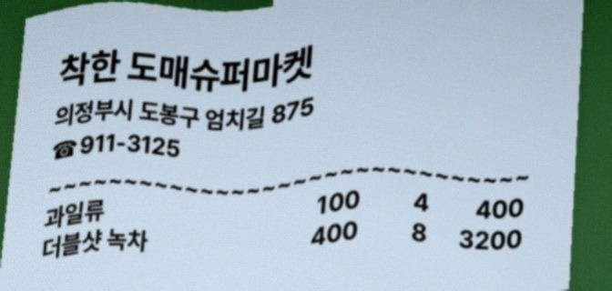

# unaveraged

Two extensions for Chrome and Firefox that read receipt CAPTCHA questions on supported NAVER
shopping pages. Inference runs on your device through WebAssembly. Each extension
fills the answer field for review. Automatic submission is off by default and can
be enabled with an explicit submit-button selector in settings.

| Extension | Questions | Default model |
| --- | --- | --- |
| [Digit](digit/README.md) | Phone-number digits and numeric street addresses | conv4-linear2 QAT |
| [VQA](vqa/README.md) | Stores, addresses, phone numbers, items, quantities and amounts | W4A8 PTQ |

Both support Korean and English. Enable one extension at a time on a page.
These projects are independent and are not affiliated with NAVER or Google.

## Models and runtime

- [Digit model](https://huggingface.co/ivere27/tiny-receipt-reader-digit-slots-2m):
  an image-only CNN that reads phone and street-number digits in one pass.
  Question routing then selects the requested digits from that record.
- [VQA model](https://huggingface.co/ivere27/tiny-receipt-vqa-structured-qa-21m):
  an encoder-decoder model that takes a receipt image and a question and generates
  a structured answer, covering store, item, quantity and amount questions as well.
- [VolvoxAI](https://github.com/ivere27/volvoxai): the deep-learning engine used
  for model conversion and quantization. Its published `volvoxai-lite` WASM runtime
  executes the models inside the extensions on your device.

The default packages use **conv4-linear2 QAT** for Digit and **W4A8 PTQ** for VQA.
The build downloads their pinned public FP32 sources from Hugging Face and
generates the quantized models locally. Digit trains and calibrates on 224 of
the [256 synthetic receipts](synth/README.md), with 32 reserved for validation;
VQA calibrates on all 256.

## Synthetic examples

These are the model repositories' public synthetic receipts, bundled locally
without image changes. The captions show expected answers from their example files.

<table>
  <tr><th>Digit · phone/address digits</th><th>VQA · receipt questions</th></tr>
  <tr>
    <td width="50%"></td>
    <td width="50%"></td>
  </tr>
  <tr>
    <td>“가게 전화번호의 뒤에서 1번째 숫자는 무엇입니까?”<br>Expected answer: <strong>6</strong></td>
    <td>“가게 이름은 무엇입니까?”<br>Expected answer: <strong>착한 도매슈퍼마켓</strong><br>“과일류 개수는 몇 개입니까?” → <strong>4</strong></td>
  </tr>
</table>

Images: Apache-2.0. [Sources, pinned revisions and hashes](docs/assets/examples/sources.json)
· [License](LICENSE) · [Attribution](NOTICE).

## Install

Download and extract an extension ZIP from GitHub Releases, or build the packages
below. Each ZIP includes its selected quantized model and WASM runtime.
Open `chrome://extensions`, enable **Developer mode**, select **Load unpacked**,
and choose the extracted folder containing `manifest.json`:

| Output | Digit | VQA |
| --- | --- | --- |
| Folder | `dist/digit/conv4-linear2/chrome/` | `dist/vqa/w4a8/chrome/` |
| ZIP | `dist/digit/conv4-linear2/unaveraged-digit-chrome.zip` | `dist/vqa/w4a8/unaveraged-vqa-chrome.zip` |

For Firefox, the same build also creates `firefox/` folders and
`unaveraged-digit-firefox.zip` / `unaveraged-vqa-firefox.zip` beside the Chrome
outputs. Open `about:debugging#/runtime/this-firefox`, select **Load Temporary
Add-on**, and choose `manifest.json` inside the extracted Firefox folder. This
development installation lasts until Firefox restarts; permanent installation
requires a Mozilla-signed package.

Chrome 116+ or desktop Firefox 140+ is required. Reload the supported page after installation.
Default watched hosts are `smartstore.naver.com` and `shopping.naver.com`, including
`/ns/home`. The receipt image, question and editable answer field must be present.
Models can answer incorrectly, and site layout changes can affect operation.

## Build

Requirements: Linux x86_64, Python 3.10+ with venv and pip/ensurepip, Node.js
22.12+, npm and GNU Make. The build installs pinned dependencies and uses the
published VolvoxAI 0.9.0 Python package and `volvoxai-lite@0.9.0` WASM runtime.

Python controls the native VolvoxAI engine: Digit QAT uses `TrainingSession`
and `AdamW`, while PTQ uses `VxQuantizationServiceClient`. ONNX conversion calls
the Python CLI, `python -m volvoxai export`; no standalone native CLI is invoked.
The browser only runs the resulting models through the lite WASM runtime.

Clone the repository and run:

```bash
make
```

The build downloads and verifies the pinned FP32 releases, converts them through
VolvoxAI, and generates the default quantized models from `synth/`. Digit uses
receipts `000000`–`000223` for training and calibration and `000224`–`000255` for
validation: two epochs, 512 samples per epoch, batch size 4, learning rate `3e-5`,
and seed `20261025`. VQA uses 256 calibration images with seed `20261027`.

Digit weight training defaults to CPU and can take substantial time. Set
`QAT_BACKEND=cuda` when a supported CUDA device is available; activation
calibration uses CPU. `JOBS=auto` (the default) requests the available logical CPU
count minus two for native training, calibration and validation sessions,
with a minimum of one. For example, 12 available CPUs select 10 threads:

```bash
make                 # Automatic CPU budget: available CPUs minus two
make JOBS=10         # Explicit native thread budget
make JOBS=1          # Single-thread model preparation
```

Models build sequentially and QAT keeps one synchronized optimizer. `JOBS`
controls native engine threads; `make -j` does not parallelize training.
VolvoxAI 0.9.0 caps its native thread pool at 16, and some CPU backward operations
are sequential. Extra threads can improve supported stages but do not guarantee
full CPU use or proportional speedups. Changing the count affects newly started
sessions, not a running build;
interrupting QAT and rerunning starts its training again. Thread counts can also
change floating-point results, so newly generated weights still require checks.

Re-running `make` rebuilds the models. `make package` reuses
the model caches under `.cache/` without training or calibration. Both browser
packages share the same model and WASM files; model preparation runs once per model.
Generated
weights and training outputs are not included in source exports.

The everyday commands are:

| Command | What it does |
| --- | --- |
| `make` | Train/calibrate the default models and build Chrome + Firefox packages. |
| `make package` | Refresh extension packages from cached models, without training. |
| `make test` | Test existing packages, without rebuilding or training models. |
| `make demo` | Stage existing packages and serve the example at `http://127.0.0.1:8000/example/`. |
| `make release` | Validate and upload local packages to the fixed model store for Pages. |
| `make clean` | Remove `dist/`; keep downloaded sources and model caches. |
| `make help` | Show this command list. |

Select a model or browser with options instead of separate commands:

```bash
make MODEL=digit QAT_BACKEND=cuda            # Train/build Digit using CUDA
make package MODEL=vqa BROWSER=firefox       # Refresh only the Firefox VQA package
make test MODEL=digit BROWSER=chrome         # Test the existing Chrome Digit package
make demo PORT=8123                          # Serve the example on another local port
```

`MODEL` and `BROWSER` default to `all`. Optional precision profiles remain
available with `PRECISION=w8a8` (both models) or another supported model profile.
Use the same `PRECISION` value when testing its packages.

See the model READMEs for input/output details. Model/runtime hashes and dependency
origins are recorded in `build-info.json`.

An existing evaluated artifact can optionally be imported with
`.venv/bin/python shared/build.py --model digit --model-source /path/to/verified/conv4-linear2`
or the equivalent `--model vqa --model-source /path/to/verified/w4a8`. These explicit imports must
match the graph, weight and provenance hashes in the corresponding
`frozen-profiles.json`; they are separate from the default fresh build.

## GitHub Releases

`make release` validates the existing four ZIPs and uploads them with
`SHA256SUMS` to the fixed `models` Release, creating it if necessary and replacing
its assets on later uploads. It never trains, calibrates or rebuilds models.
This Release is a model store; its tag is not the Pages source revision.
No `TAG` input is needed. Use `make release DRY_RUN=1` for an offline preview or
`make release ACTION=check` for local validation only.

For a separate versioned extension release, supply `TAG=vX.Y.Z` as below.

Install [GitHub CLI](https://cli.github.com/), sign in with `gh auth login`, and
push the release commit to GitHub. After the first `make`, refresh packages when
extension source changes, test them and publish:

```bash
make package
make test
make release TAG=v0.1.0 REPO=OWNER/REPO
```

`release` uploads four production ZIPs: Chrome and Firefox packages for
**Digit conv4-linear2 QAT** and **VQA W4A8 PTQ**, plus `SHA256SUMS`.
It checks model hashes, runtime, production configuration and
archive contents before uploading.
A new tag targets the current commit. `TAG` is the repository release version;
the extension and runtime versions remain recorded inside each ZIP.
Omit `REPO` when GitHub CLI can infer it from the Git remote.

Use `DRY_RUN=1` to validate the ZIPs and preview the command without uploading,
or `DRAFT=1` to create a draft release. For a release that already exists:

```bash
make release ACTION=upload TAG=v0.1.0 REPO=OWNER/REPO
```

Add `CLOBBER=1` to replace assets with the same names. Release commands use the
existing default builds in `dist/`. `make release ACTION=check` validates them
offline without a GitHub login. Re-run `make` when changing model generation;
`make package` is sufficient for extension-only changes.

## Performance

[Benchmark results and reproduction](benchmarks/README.md) cover the latest
VolvoxAI 0.9.0 measurements, the 13-model Digit comparison, VQA timings and
model identities. Measurements describe fixed recorded artifacts; newly trained
or calibrated models need their own evaluation.

## Test

```bash
make test                              # Verify existing packages in both browsers
make test MODEL=digit                   # Verify one model
make test BROWSER=firefox               # Run browser checks only in Firefox
```

`make test` does not retrain or regenerate the packaged models. Build once with `make`,
or refresh cached packages with `make package` before testing changes.
Checks cover native ONNX parity, preprocessing, model outputs and real Chrome/Firefox
extension behavior. They use public synthetic receipts and local intercepted
responses, without contacting NAVER. Reports stay in ignored `test-results/`.
Set `RECEIPT_CHROME=/path/to/chrome` to use an existing Chrome installation.
Set `RECEIPT_FIREFOX=/path/to/firefox` to use an existing Firefox installation.

## Settings and diagnostics

Open the extension popup and choose **설정** (Settings). Settings are local to each
installed reader and browser. The page supports:

- Watched URL patterns, an optional container CSS selector, and image/question/answer selectors.
- Worker count (1–4), total admitted requests (1–64, including active reads), and idle timeout (default 60 seconds).
- Automatic submission, **off by default**. When enabled, a visible, enabled button matching the configured selector is clicked only after a successful automatic answer fill. Edited, stale, unsupported or failed results are not automatically submitted. Manual **답 입력** does not trigger automatic submission.
- Optional engine profiling with bounded worker/queue/error history, plus status refresh and local diagnostic export.

Grant access when adding a new watched site, then reload its open pages. CSS
selectors must match that site's receipt image, question, answer and optional
submit button. Additional sites still need to use the receipt/question formats
supported by the selected model. More workers load more copies of the model and
use more memory. Model batch size remains 1; worker count controls concurrent
requests, not tensor batching.

## Inference memory lifecycle

Each extension shares its configured worker pool across tabs (one worker by
default). Workers load models on demand. After the last read finishes, the
configured idle timeout (one minute by default) terminates every worker, releasing
its model, WASM heap and result cache.
Status checks do not extend this deadline, and active reads finish before idle
cleanup. The next read creates a fresh worker and loads the model again.

Chrome also closes its offscreen document. Firefox uses a non-persistent
background page, which the browser may unload earlier when idle. This releases
the inference resources; the installed extension, toolbar button and small
content script on open supported pages remain available. Browser scheduling and
memory allocators determine when the released memory disappears from process
memory measurements.

## Privacy and public documentation

The extensions do not send receipts, questions or inference results to the
developer. Results are cached in memory; idle inference workers are released
after approximately one minute by default. Preferences are saved locally; optional
diagnostic exports contain execution metadata. The target website can read answers filled
into its input field. See the [privacy policy](PRIVACY.md) for the full scope.

Markdown files are the documentation sources. `make docs` renders them into
`dist/pages/`; `make demo` and the Pages workflow render them automatically.
`README.md` becomes `index.html`, `PRIVACY.md` becomes `privacy.html`, and the
model, synthetic-data, benchmark and store guides each become a page.
Benchmark tables are generated from the two JSON reports in `benchmarks/`.
The same Markdown renderer builds the extension's packaged privacy page.
Edit the Markdown or benchmark JSON, never the generated HTML.

For GitHub Pages, choose **Settings → Pages → Source → GitHub Actions** and use
the workflow described below. Neither the repository root nor `/docs` is a
publishable site. `docs/` contains only site assets and renderer dependencies;
the interactive `example/` and extension HTML files remain authored UI sources.
See [store registration notes](STORE.md) for listing details.

`python3 shared/build.py --source` exports the source allowlist to `dist/source/` and
`dist/unaveraged-source.zip`, excluding Git history, caches and private datasets.
`make clean` removes build outputs. Source/build scripts and models are
Apache-2.0; VolvoxAI and adapted routing/tokenizer code are MIT. See
[LICENSE](LICENSE) and [NOTICE](NOTICE).

## Attention heatmaps and live example

Heatmap capture is **on by default** in settings. Both the receipt panel and
extension popup start with **Show heatmap** enabled; switching the view does not
run inference again. The overlay uses real final-layer attention: Digit selects
the requested digit slots (42 × 10), while VQA averages the final decoder cross
attention over eight heads and answer tokens (21 × 10 image cells). Colors show
relative intensity within that image, not causal attribution or confidence.
The packaged model and weights remain unchanged; the runtime exposes existing
attention tensors through a derived graph output contract.

Rendering rasterizes the small attention grid once per result and lets the
browser scale it over the receipt. There is no continuous rendering loop or
idle polling. Only one popup preview is held in memory, cleared on worker
release or when heatmaps are disabled. Profiling remains optional and bounded;
no receipt images are written to diagnostic exports.

The original UI in `example/` offers the two licensed public model examples and
all 256 receipts in `synth/`. Only the selected image is downloaded. Choose a
question preset or type your own; presets adapt to the model and receipt fields,
including phone positions, street numbers, stores, item quantities, prices and
totals. Correctness badges appear only when a matching annotation answer is
known. The demo runs one worker only after **Run** is clicked and releases it
after one idle minute; changing the receipt or question reuses the loaded model.
Stage and serve the existing packaged models with one command:

```bash
make demo
```

Open `http://127.0.0.1:8000/example/`; use `PORT=8123` to change the port and
Ctrl-C to stop. This does not rebuild models. After extension code changes,
run `make package` first. To stage files without starting a server, run
`.venv/bin/python shared/pages.py`.

For hosting, choose **Settings → Pages → Source → GitHub Actions** once.
Models are generated **only on your local machine**. Prepare and upload them:

```bash
make package        # Reuse existing locally generated models
make release        # Create/update the fixed model store; no TAG input needed
```

If model caches do not exist yet, run `make` locally before packaging. Run local
checks with `make test` before uploading changed models. GitHub never runs model
training, conversion or calibration, and does not generate replacement models
when assets are missing. Missing or incompatible uploads stop deployment.

The **Build and publish example** workflow deploys on pushes to the default
branch (`main` in this repository; `master` is also supported). After committing
source changes, push:

```bash
git push origin main
```

Actions downloads the locally built Chrome ZIPs and `SHA256SUMS` from the fixed
`models` Release. It verifies checksums, keeps model and vendor runtime bytes
unchanged, and combines them with the current branch's documentation, demo and
compatible adapter/runtime glue code. Model binaries stay out of Git history.
The browser serves all required files from the Pages origin; the demo identifies
its source commit and the uploaded model archive hashes. Source-only changes
can reuse the same model upload. When local models change, run `make release`
again, then push source changes or manually run the workflow with **deploy** checked.

For a downloadable preview without deployment, run the workflow manually with
**deploy** unchecked on the default branch. Versioned extension Releases remain
optional; Pages always uses the fixed local-model store.

A private personal repository needs GitHub Pro for Pages. The repository can
remain private while the site is public; deployed HTML, JavaScript and model
files are then publicly downloadable. Private model assets are downloaded by
Actions with its repository token; no token is included in the site.
